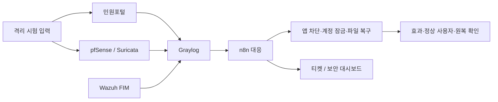

# NoBugs · ALEPH SOAR

**가상 해담시청 민원 서비스의 공격 탐지·자동 대응·원복을 검증하는 보안 프로젝트**

1조 **NoBugs** · 조장 **김명준** · 기본 브랜치 **main**
진행 현황 기준: **2026-10-29 / Asia/Seoul**

공격 신호를 모으는 데서 끝나지 않고, 실제 차단·복구 효과와 정상 사용자 영향,
티켓 기록과 원복까지 확인하는 것이 목표입니다. 모든 공격 시험은 팀의 격리된 실습 환경에서 수행합니다.
실제 공공기관 서비스나 데이터와 관계없는 교육용 시스템입니다.

## 빠른 안내

- [현재 검증 현황과 한계](docs/verification.md)
- [구성도와 처리 흐름](docs/architecture.md)
- [담당·시나리오](docs/scenarios.md)
- [구현 저장소와 평가 접근 방법](docs/repositories.md)
- [공개 범위와 갱신 기준](docs/publication-policy.md)

이 저장소는 **평가·진행 확인용 공개 문서 저장소**입니다. 실행 가능한 전체 소스나
배포 패키지는 포함하지 않습니다. 구현은 아래 비공개 저장소 3개에서 진행합니다.

| 저장소 | 용도 | 접근 |
| --- | --- | --- |
| [aleph-soar-capstone](https://github.com/NoBugs-Aleph/aleph-soar-capstone) | 관제·대응 연동, 계약, 시험·증적, 보안 대시보드·티켓 | 비공개 |
| [haedam-portal-backend](https://github.com/NoBugs-Aleph/haedam-portal-backend) | Flask 민원 API·인증·대응 API | 비공개 |
| [haedam-portal-frontend](https://github.com/NoBugs-Aleph/haedam-portal-frontend) | React 민원포털·관리자 화면 | 비공개 |

## 기술 구성

React · Flask · MySQL · pfSense/OpenVPN · Suricata · Wazuh · Graylog · n8n · Docker · Kali Linux

그림은 목표 연결 구조입니다. 각 연결의 실제 검증 상태는 [검증 현황](docs/verification.md)을 따릅니다.

## 현재 성과

- 민원포털과 분산 관제 환경을 구성했습니다.
- S1·S4·S7·S8·S10의 보강 전 시험 기록을 확보했습니다.
- **S1 보강 후 첫 시험(10/28)**에서 자동 차단·티켓·정상 사용자 대조·사람 승인 후 해제와 최종 원복을 확인했습니다.
- S4 수동 잠금/해제, S7 수동 Wazuh 복구 시험은 자동 상관탐지 전체 완주와 구분해 기록합니다.
- 나머지 케이스의 전체 자동 경로, 정상·경계 입력, 반복 검증과 발표 자료는 진행 중입니다.

## 팀 역할

| 자리 | GitHub | 주요 책임 |
| --- | --- | --- |
| A | whiteclover0542 | 포털·대응 API, S1/S4 |
| B | myeongjundev | 망·VPN·DB·시험 출발지, S8/S10·통합 조율 |
| C | shk12170-dev | Wazuh·S7, 티켓 저장소·보안 대시보드 |
| D | chacha1650a | Graylog·n8n·S12 |

## 일정

기획서 제출 10/23 · 리허설 11/5 · 본발표 11/6 (2026년).
반복 측정·종합 리포트는 리허설 전 정리를 목표로 합니다.
