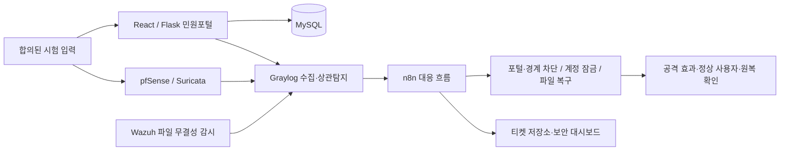

# NoBugs · ALEPH SOAR

### 해담시청 민원 서비스 보안 관제·자동 대응 프로젝트

**공격 신호를 모으는 데서 나아가, 실제 차단 효과·정상 사용자 영향·조치 해제까지 대조하는 교육용 팀 프로젝트입니다.**

1조 **NoBugs** · 조장 **김명준** · 4인 팀

문서 갱신 **2026-11-04** · 실습 결과 기준 **2026-11-03 (KST)** · 프로젝트 진행 중

[검증 현황](docs/verification.md) · [S8·S10 실측 해설](docs/integration-walkthrough.md) · [김명준의 담당·기여](docs/member-contribution.md) · [남은 과제](docs/roadmap.md)

## 프로젝트 소개

가상 해담시청 민원포털의 앱·인증·호스트·네트워크 로그를 수집하고, 서로 연결되는 신호를 판정해 대응합니다.
대응 API의 성공 응답과 실제 차단 효과를 구분하고, 정상 사용자의 접근과 해제 후 복귀를 함께 확인합니다.

시민은 민원 작성·제출·조회, 담당자는 배정된 민원 처리·답변, 관리자는 계정·이용 상태 관리를 수행하는 구성입니다.
이 업무가 보안 검증의 보호 대상이며, 모든 사용자 동선을 공격 중 동시에 검증한 것은 아닙니다.
실제 공공기관의 서비스·데이터를 사용하는 프로젝트가 아니며, 시험은 팀 실습 환경에서 수행했습니다.

이 저장소에는 **검토한 공개 문서만** 있습니다. 실행 소스·배포 환경·원문 로그·현장 캡처·시연 영상은 포함하지 않습니다.
개인 방어전과 NetProof 프리미엄 실습은 이 프로젝트의 성과에 포함하지 않습니다.

## 11월 3일까지 확인한 결과

| 케이스 | 확인한 동작 | 해석과 남은 확인 |
| --- | --- | --- |
| S1 · 저속 계정 공격 | 10/28 첫 보강 후 회차에서 자동 차단·티켓·정상 사용자 대조·승인 후 해제 | [당시 실측 기록](docs/s1-walkthrough.md) 보존. 독립 반복·경계 조건 검증은 계속 진행 |
| S4 · 로그인 실패·성공 결합 | 11/3 자동 계정 잠금·세션 회수, 정상 계정 유지, 비밀번호 재설정·재로그인·티켓 종료 | 첫 실제 회차. 독립 반복과 임계값 직전 조건의 현장 시험은 미완료 |
| S7 · 파일 변조·웹 접근 결합 | FIM·웹 접근 상관탐지와 11/2 실제 티켓 저장 확인 | 실제 자동 복구·격리와 원복을 잇는 전체 흐름은 미검증 |
| S8 · 웹 스캔·인증 신호 결합 | 11/3 LIVE02에서 공격 접근 403·정상 접근 200, 해제 후 200·잔여 차단 없음·티켓 종료 | 앞선 LIVE01 웹훅 실패와 구분. 효과·해제 기록에는 담당자 개입 포함 |
| S10 · 앱·인증·경계 신호 결합 | 11/3 LIVE01에서 pfSense·포털 차단 효과를 각각 확인하고 순차 해제·최종 접근 복귀·티켓 종료 | PF 단독 인수 재시험과 실제 탐지 회차를 구분. 다중 사건·반복 시험은 남음 |
| S12 · 부하·응답 지연 | 11/3 정상 기준 측정과 부하 회차 수행, 탐지 뒤 health 판정은 `no_action` | 차단·서비스 회복은 검증하지 못함. health와 정상 사용자 경로의 측정 차이 점검 필요 |

S4·S8·S10의 위 결과는 **해당 실제 회차의 결과**입니다. 전 케이스 완료나 모든 단계의 무인 자동화를 뜻하지 않습니다.
담당자 승인, 수동 효과 기록과 해제 호출을 구분하고, 로컬 시험 수를 현장 성공률로 환산하지 않습니다.

## 구성과 검증 흐름

역할별 4대 PC에 포털·DB·네트워크·관제 구성요소를 나누고 팀 VPN으로 연결하는 실습 구성입니다.

그림은 전체 설계이며, 파일 복구 등 미검증 경로도 포함합니다.
[구성과 검증 흐름](docs/architecture.md)과 [케이스별 검증 현황](docs/verification.md)을 함께 확인해 주세요.

| 보안 목적 | 보호 대상 | 연결 케이스 |
| --- | --- | --- |
| 기밀성 | 계정·세션·서비스 접근 | S1·S4 |
| 무결성 | 홈페이지 파일과 정상 기준본 | S7 |
| 가용성 | 정상 사용자의 서비스 이용 | S12 |
| 여러 신호의 결합 | 웹·인증·네트워크 경계 | S8·S10 |

## 대표 검증: 차단 요청과 실제 효과를 구분하기

**S8:** 첫 입력에서는 웹훅 미등록으로 대응 호출이 실패했습니다.
담당자가 등록 상태를 복구한 뒤 새 회차에서 공격 출발지의 403과 정상 출발지의 200을 대조했고,
해제 후 접근 200·잔여 차단 없음·티켓 종료를 확인했습니다.

**S10:** PF 단독 첫 인수에서는 자동 해제가 실패해 B 담당자가 수동 정리했습니다.
도구 보완 뒤 별도 재인수에서 차단·해제·잔여 없음이 확인됐습니다.
이후 실제 상관탐지 회차에서는 PF를 먼저 해제해 포털의 403을 확인하고, 포털도 해제해 양쪽 접근 복귀를 대조했습니다.

[문제 → 보완 → 재시험 해설](docs/integration-walkthrough.md)에서 실패 회차·재시험·남은 한계를 확인할 수 있습니다.

## 팀 역할과 AI 활용

| 자리 | GitHub | 주요 담당 |
| --- | --- | --- |
| A | whiteclover0542 | 포털·대응 API, S1/S4, 포털 원본 대조 |
| B · 김명준 | myeongjundev | pfSense·VPN·DB·Kali 기반, S8/S10 시험 입력·네트워크 효과 확인, 통합 조율 |
| C | shk12170-dev | Wazuh·S7, 티켓 저장소·보안 대시보드 |
| D | chacha1650a | Graylog·n8n·S12, 탐지·대응 흐름 연결 |

김명준은 초기 React·Flask 포털 작업에도 AI 도구를 활용했습니다.
현재 담당은 네트워크 기반과 B 시험·통합 검증이며, 팀 전체 구현과 다른 담당자의 결과를 개인 단독 성과로 표기하지 않습니다.

Codex·Claude를 코드·시험 도구 작성과 수정, 명령 실행 지원, 결과 분석과 문서 정리에 활용했습니다.
담당 영역의 기록이 곧 모든 코드의 독립 작성이나 모든 명령의 직접 실행을 뜻하지는 않습니다.
개인 역할과 팀원 보고·AI 작업의 구분은 [김명준의 담당·기여](docs/member-contribution.md)에 정리했습니다.

**서비스:** React · Flask · MySQL

**네트워크·관제·대응:** pfSense · OpenVPN · Suricata · Wazuh · Graylog · n8n

**실습 기반:** Docker · Kali Linux

## 문서 안내

| 확인 목적 | 문서 |
| --- | --- |
| 현재 성과와 미검증 범위 | [검증 현황·근거 기준](docs/verification.md) |
| 최신 대표 회차의 실패·재시험 | [S8·S10 통합 검증 해설](docs/integration-walkthrough.md) |
| 김명준의 개인 담당과 AI 활용 | [네트워크 기반 구성 및 통합 검증](docs/member-contribution.md) |
| 초기 자동 차단의 구체적 시각 | [10/28 S1 첫 실측 해설](docs/s1-walkthrough.md) |
| 구성·설계 이유 | [아키텍처](docs/architecture.md) · [설계 의도](docs/design-decisions.md) |
| 효과·중복·해제의 확인 수준 | [대응 보호 장치](docs/response-assurance.md) |
| 오류 원인과 수정 범위 | [문제 해결 과정](docs/engineering-notes.md) |
| 증거 자료의 해석·추가 공개 기준 | [증적 안내](docs/evidence-guide.md) · [공개 정책](docs/publication-policy.md) |
| 시나리오·후속 작업 | [케이스 설계](docs/scenarios.md) · [로드맵](docs/roadmap.md) |

## 구현 저장소와 원본 열람

| 저장소 | 내용 | 접근 |
| --- | --- | --- |
| [aleph-soar-capstone](https://github.com/NoBugs-Aleph/aleph-soar-capstone) | 관제·대응·티켓·계약·시험 증적 | 비공개 |
| [haedam-portal-backend](https://github.com/NoBugs-Aleph/haedam-portal-backend) | Flask 민원·인증·대응 API | 비공개 |
| [haedam-portal-frontend](https://github.com/NoBugs-Aleph/haedam-portal-frontend) | React 시민·직원·관리자 화면 | 비공개 |

공개 문서는 원본 기록을 대조해 작성한 요약입니다. 원본 열람이 필요한 평가자는
[평가 접근 안내](docs/repositories.md)를 따릅니다. 내부 주소·인증 정보·원문 DB·비공개 이력은 공개하지 않습니다.

## 다음 단계

S12의 측정 경로·시점 차이 확인 → S7 실제 자동 복구·격리와 원복 검증 → 시연 자료 정리·녹화를 우선합니다.
독립 반복·경계 조건과 배포본/저장소 버전 대조도 남아 있습니다.
리허설 **11/5**, 본발표 **11/6**은 예정 일정이며 완료 실적으로 표기하지 않습니다.

이 갱신은 11월 3일까지의 기록을 정리한 문서 변경입니다. 11월 4일의 새 현장 시험·최종 제출 완료를 뜻하지 않습니다.
