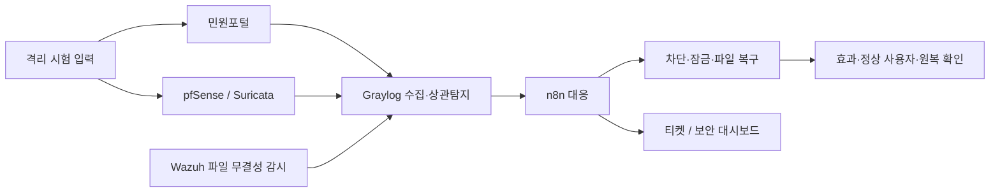

# NoBugs · ALEPH SOAR

### 해담시청 민원 서비스 보안 관제·자동 대응 프로젝트

**공격 탐지부터 실제 대응, 정상 사용자 확인, 원복까지 검증합니다.**

1조 **NoBugs** · 조장 **김명준** · 4인 팀 · **2026-10-29 오전 기준**

[검증 현황](docs/verification.md) · [S1 첫 실측 결과](docs/s1-walkthrough.md) · [다음 목표](docs/roadmap.md) · [구현 저장소](docs/repositories.md)

## 처음 방문하셨나요?

| 확인 목적 | 추천 읽는 순서 |
| --- | --- |
| 프로젝트 이해 | 아래 서비스 기능 → 구성도 → 담당별 케이스 현황 |
| 실제 성과 확인 | [S1 사건 타임라인](docs/s1-walkthrough.md) → [검증 결과와 한계](docs/verification.md) |
| 구현·증적 검토 | [구현 저장소와 평가 접근 안내](docs/repositories.md) |

## 지금 어디까지 진행했나요?

**공통 수집·대응 기반을 연결하고, S1 보강 후 첫 실제 시험을 마쳤습니다.**
현재는 정상·경계·반복 시험과 나머지 케이스의 자동 대응 검증을 진행하는 단계입니다.

| 확인 항목 | 현재 근거 | 범위 |
| --- | --- | --- |
| 보강 전 시험 | **6개 측정 케이스 중 5개** 기록 확보 | S1·S4·S7·S8·S10, S12는 대기 |
| 보강 후 첫 시험 | **S1-after-01 1회 마감** | 10/28 자동 차단·티켓·정상 사용자 대조·승인 후 해제·최종 원복 |
| S4·S7 대응 수단 | 수동 동작 검증 기록 확보 | S4 잠금/해제·로그인, S7 Wazuh 복구/격리 |
| 반복·경계·다른 케이스 | **진행 중** | 독립 N=5 및 나머지 자동 경로는 완료로 표시하지 않음 |

내부 차단 3건을 독립 시험 3회로 세지 않습니다. 위 개수는 제품 완성도나 탐지율이 아닙니다.
오늘의 추가 입력·반복 측정은 오전 준비 단계이며, 이 공개본에 새 성공 결과로 반영하지 않았습니다.

## 해담시청 민원포털은 어떤 서비스인가요?

시민이 민원을 접수하고 처리 상태를 조회하며, 담당자가 배정된 민원에 답변하고,
관리자가 계정·이용 상태를 관리하는 교육용 웹 서비스입니다.
이 정상 업무를 유지하면서 공격 탐지·대응의 효과와 영향을 검증합니다.

| 사용자 | 주요 업무 | 보안 검증에서의 역할 |
| --- | --- | --- |
| 시민 | 민원 작성·제출·조회, 접수 확인 | 정상 서비스 이용과 접근 권한 대조 |
| 담당자 | 배정된 민원 확인·처리·답변 | 보호할 업무 계정과 세션 |
| 관리자 | 계정·권한·잠금 상태 관리 | 잠금·해제와 담당자 조치 확인 |

위 표는 서비스 기능을 설명합니다. 모든 사용자 동선을 공격 중 동시에 검증했다는 뜻은 아닙니다.

## 어떤 문제를 해결하나요?

가상 해담시청 민원포털의 계정 공격·웹 스캔·홈페이지 변조·서비스 장애 신호를
앱·네트워크·호스트에서 수집합니다. 상관탐지 후 실제 대상에 대응하고,
티켓과 정상 사용자 영향, 조치 해제·복구를 함께 대조합니다.

모든 공격 시험은 팀의 격리된 실습 환경에서 수행합니다.
실제 공공기관 서비스나 데이터를 사용하는 프로젝트가 아닙니다.

그림은 목표 구조입니다. **모든 케이스의 연결 완료를 뜻하지 않습니다.**
[구성과 검증 흐름](docs/architecture.md)에서 각 구성요소의 역할을 설명합니다.

## 보안 3대 원칙과 연결

| 원칙 | 보호 대상 | 연결 시나리오 | 검증 방향 |
| --- | --- | --- | --- |
| 기밀성 | 계정·세션·서비스 접근 | S1·S4 | 공격 계정/출발지를 제어하고 정상 사용자 유지 |
| 무결성 | 홈페이지 파일 | S7 | 변경·접근을 연결하고 정상 기준본 복구 |
| 가용성 | 정상 사용자의 서비스 이용 | S12 | 기준선과 공격 중 응답·회복 비교 |

S8·S10은 앱·인증·네트워크 경계의 신호를 결합하는 시나리오입니다.
위 원칙은 설계 목표이며, 실제 확인한 범위는 아래 케이스 현황을 따릅니다.

## 담당별 케이스 현황

| 담당 | 케이스 | 확인한 것 | 다음 확인 |
| --- | --- | --- | --- |
| A | S1 계정 공격 | 보강 전 + 보강 후 첫 시험 | 독립 반복·정상/경계 입력 |
| A | S4 실패·성공 결합 | 보강 전 + 수동 잠금·해제 | 자동 잠금·세션 회수·원복 전체 경로 |
| C | S7 홈페이지 변조 | 보강 전 + 수동 Wazuh 복구 | 상관탐지→n8n→복구·티켓 전체 경로 |
| B | S8 스캔·로그인 결합 | 보강 전 + 규칙·도구 준비 | 보강 후 자동 차단·원복 |
| B | S10 경계 신호 결합 | 보강 전 + PF 도구 준비 | 실제 경계 차단·기존 연결 제거·원복 |
| D | S12 서비스 장애 | VPN 경로 정상 기준선 | 정상 사용자 경로 기준선·보강 전후 부하/회복 |

[케이스 설계](docs/scenarios.md)와 [검증 결과·한계](docs/verification.md)를 함께 확인해 주세요.

## S1에서 실제로 확인한 흐름

**로그인 실패 → Graylog 탐지 → n8n 자동 차단 → 티켓 → 정상 사용자 대조 → 사람 승인 후 해제 → 최종 원복**

- 10/28 전체 시험 1회 안에서 자동 차단 3건을 관찰했습니다.
- 기록된 탐지 지연은 약 **59.6 / 53.4 / 47.3초**입니다. 현장 시계와 측정 정의의 제약을 포함합니다.
- 해제는 임시 호출과 수동 기록을 포함합니다. 승인 해제까지 모두 자동화됐다고 주장하지 않습니다.
- [첫 실측 해설](docs/s1-walkthrough.md)에 보강 전후 차이와 남은 검증을 정리했습니다.

## 설계와 검증을 더 자세히 보기

| 읽을 거리 | 설명 |
| --- | --- |
| [해결하려는 문제·설계 의도](docs/design-decisions.md) | 보호 대상, 기술별 역할, 앱/경계·사건/자원 구분 |
| [대응 보호 장치](docs/response-assurance.md) | 중복·소유권·정상 사용자·효과·승인 해제의 확인 수준 |
| [문제 해결 과정](docs/engineering-notes.md) | 본문 미전송, 수신 중단, 지연 효과, 시계 오차를 좁혀 간 과정 |
| [시연·증적 안내](docs/evidence-guide.md) | 장면별 증명할 사실과 공개 전 확인 기준. 화면·영상은 아직 미게시 |

## 구현과 공개 자료

이 저장소는 **평가·진행 확인용 공개 문서 저장소**이며, 기본 브랜치는 **main**입니다.
공개된 자료는 소개·구성·시나리오·검증 요약·로드맵입니다.
전체 구현 소스·원문 증적·실행 환경·발표 영상은 이 저장소에 포함하지 않았습니다.

| 구현 저장소 | 용도 | 접근 |
| --- | --- | --- |
| [aleph-soar-capstone](https://github.com/NoBugs-Aleph/aleph-soar-capstone) | 관제·대응·티켓/대시보드·계약·시험 증적 | 비공개 |
| [haedam-portal-backend](https://github.com/NoBugs-Aleph/haedam-portal-backend) | Flask 민원 API·인증·대응 API | 비공개 |
| [haedam-portal-frontend](https://github.com/NoBugs-Aleph/haedam-portal-frontend) | React 시민·직원·관리자 화면 | 비공개 |

평가자의 원본 열람은 [접근 안내](docs/repositories.md)를 따릅니다.
공개 자료의 범위와 갱신 원칙은 [공개 정책](docs/publication-policy.md)에 있습니다.

## 팀과 기술

| 자리 | GitHub | 주요 책임 |
| --- | --- | --- |
| A | whiteclover0542 | 포털·대응 API, S1/S4 |
| B | myeongjundev | 망·VPN·DB·시험 입력, S8/S10·통합 조율 |
| C | shk12170-dev | Wazuh·S7, 티켓 저장소·보안 대시보드 |
| D | chacha1650a | Graylog·n8n·S12 |

**서비스:** React · Flask · MySQL
**관제·대응:** pfSense/OpenVPN · Suricata · Wazuh · Graylog · n8n
**실습 환경:** Docker · Kali Linux

## 남은 일정

기획서 제출 **10/23** → 현재 검증·반복 측정 → 리허설 **11/5** → 본발표 **11/6** (2026년).
[로드맵](docs/roadmap.md)은 완료한 일과 다음 목표를 분리해서 관리합니다.
